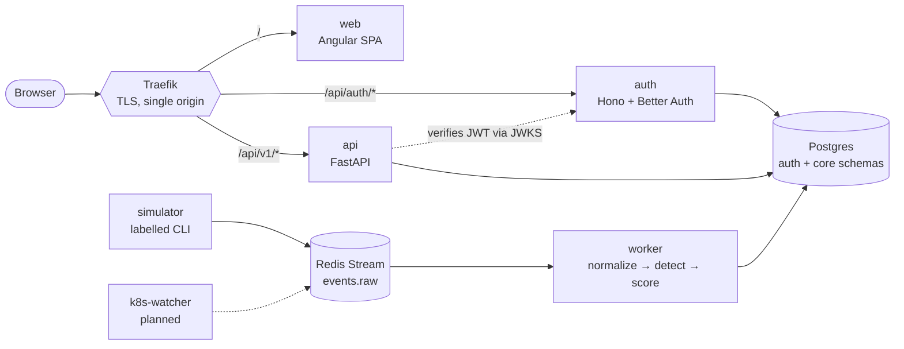

<p align="center">
  <picture>
    <source media="(prefers-color-scheme: dark)" srcset="https://shieldcn.dev/header/graph.svg?title=Ephoros&subtitle=Ephemeral+Cloud+%26+Kubernetes+Resource+Risk+Detection&logo=kubernetes&align=left&mode=dark" />
    
  </picture>
</p>

<p align="center">
  <a href="https://github.com/Yaswanth6303/ephoros/actions/workflows/ci.yml"></a>
  <a href="#roadmap"></a>
  <a href="https://angular.dev"></a>
  <a href="https://fastapi.tiangolo.com"></a>
  <a href="https://www.python.org"></a>
  <a href="https://nodejs.org"></a>
</p>

Cloud-native environments constantly create and destroy short-lived resources: CI/CD pods, spot VMs,
temporary IAM sessions. Daily inventory scans miss them. **Ephoros** discovers these transient assets
in near real time, detects risky behaviour, correlates detections into incidents, scores them and
explains them for analysts.

Built for the iamneo × Société Générale challenge
[_Ephemeral Cloud & Kubernetes Resource Risk Detection_](https://societegenerale.iamneo.ai/ephemeral-cloud-kubernetes-resource-risk-detection/).

## Contents

- [What works today](#what-works-today)
- [Architecture](#architecture)
- [Tech stack](#tech-stack)
- [Quick start](#quick-start)
- [Everyday commands](#everyday-commands)
- [Repository layout](#repository-layout)
- [Testing and quality](#testing-and-quality)
- [Roadmap](#roadmap)
- [Docs](#docs)

## What works today

- **Single HTTPS origin** at `https://ephoros.localhost`. Traefik routes the web app, auth and API.
- **Sign-in with roles.** Better Auth issues JWTs, and FastAPI verifies them through JWKS. Admins
  create users; public sign-up is off. Angular route guards protect `analyst` and `admin` pages.
- **Labelled simulator.** It generates reproducible Kubernetes, cloud and CI activity, including
  attack scenarios, with ground-truth labels kept apart from the data.
- **Ingest pipeline.** Raw events go through a Redis Stream to a worker that normalizes them into an
  OCSF-inspired schema and stores them in Postgres. Bad records go to a dead-letter stream, so they
  never stall ingestion.
- **Events API.** `GET /api/v1/events` pages through stored events with an opaque keyset cursor. The
  TypeScript client is generated from FastAPI's OpenAPI document.

Detection, scoring, incidents and the dashboard are next. See the [roadmap](#roadmap).

## Architecture



Python is **one codebase run as several processes**: `api` and `worker` share one package with
hexagonal boundaries (domain, services, adapters) and one Docker image. Each process scales on its
own. The full design is in the [design spec](docs/superpowers/specs/2026-10-10-ephoros-design.md).

## Tech stack

| Layer          | Tools                                                                                              |
| -------------- | -------------------------------------------------------------------------------------------------- |
| Frontend       | Angular 22 (zoneless, signals, Signal Forms), Spartan/ui, Tailwind CSS v4                          |
| Auth           | Hono, Better Auth (JWT + admin plugins), Drizzle ORM                                               |
| API and worker | FastAPI, SQLAlchemy 2 (async), Alembic, Pydantic                                                   |
| Data           | PostgreSQL 17, Redis 7 (Streams)                                                                   |
| Edge           | Traefik v3 with a locally trusted mkcert certificate                                               |
| Monorepo       | Nx, pnpm, uv, mise (pinned tool versions), just (task runner)                                      |
| Quality        | Vitest, pytest + Testcontainers, Playwright, ESLint, Ruff, mypy, import-linter, lefthook, gitleaks |

## Quick start

**Prerequisites:** [mise](https://mise.jdx.dev) and Docker (Docker Desktop, Rancher Desktop or
Colima). Keep at least 15 GB of free disk space for the images.

```sh
mise install               # pinned node, pnpm, python, uv, just, mkcert, …
just setup                 # pnpm + uv dependencies, git hooks
cp .env.example .env
just certs                 # trusted local TLS cert (asks for your password once)
just up                    # Traefik, web, api, auth, worker, Postgres, Redis
just migrate && just seed  # auth + core tables, dev admin/analyst users from SEED_* in .env
```

Open <https://ephoros.localhost> and sign in with a `SEED_*` account from `.env`.

To fill the system with data, replay the simulator:

```sh
just simulate              # seed 7, replayed into the ingest stream
```

## Everyday commands

Run `just` to list everything. The ones you'll use most:

| Command                                     | What it does                                             |
| ------------------------------------------- | -------------------------------------------------------- |
| `just dev`                                  | Infra in Docker; web and API with hot reload             |
| `just up` / `just down`                     | Start or stop the full stack                             |
| `just logs`                                 | Follow container logs                                    |
| `just test`                                 | Unit and integration tests for every project             |
| `just lint` / `just typecheck` / `just fmt` | Static checks and formatting                             |
| `just e2e`                                  | Full stack + Playwright browser tests                    |
| `just gen-client`                           | Regenerate the TypeScript API client after an API change |
| `just simulate 42`                          | Generate and replay a different simulated dataset        |

## Repository layout

```text
apps/
  web/            Angular dashboard
  web-e2e/        Playwright browser tests
  auth/           Hono + Better Auth service
  api/            FastAPI app and worker (one Python package, several entrypoints)
libs/
  py/
    detection-core/  normalization and (soon) detection logic, no I/O
    simulator/       labelled scenario generator and replayer
  shared/
    api-contract/    TypeScript client generated from OpenAPI
  web/               one folder per domain, plus shared/ for what several libraries use
    auth/
      domain/          user model and role rules (no Angular, no HTTP)
      data-access/     auth store, guards, interceptor
      feature-login/   login page
    shared/
      ui/              Spartan/ui components and interactions
      util/            small framework-free helpers
infra/            Traefik config and local certificates
docs/             design spec and milestone plans
```

## Testing and quality

Every push runs [GitHub Actions CI](.github/workflows/ci.yml):

- **checks:** lint, type checks, unit and integration tests, production builds, and a check that the
  generated API client matches the API
- **security:** secret and dependency scanning
- **images:** Docker image builds

Locally, lefthook runs formatting, linting and commit-message checks
([Conventional Commits](https://www.conventionalcommits.org)) before each commit.

## Roadmap

Each milestone ends with a working, demoable system.

| #   | Milestone                                                                              | Status  |
| --- | -------------------------------------------------------------------------------------- | ------- |
| 1   | **Foundation:** workspace, Compose stack, CI, OpenAPI codegen                          | ✅ Done |
| 2   | **Auth:** Better Auth, JWKS verification, Angular login and guards                     | ✅ Done |
| 3   | **Data:** simulator, normalized schema, Redis ingest, event storage                    | ✅ Done |
| 4   | **Detection v1:** enrichment, classification, rules, scoring, incidents, evaluation    | ⏳ Next |
| 5   | **Dashboard v1:** overview, inventory, identities, incidents, live updates, CSV export |         |
| 6   | **Advanced detection:** statistics, Isolation Forest, graph correlation                |         |
| 7   | **AI:** provider layer, incident narratives, copilot, natural-language search          |         |
| 8   | **Live Kubernetes:** kind, audit log watcher, Helm chart, demo scenarios               |         |
| 9   | **Polish:** observability, full Playwright suite, docs, evaluation report              |         |

## Docs

- [Design spec](docs/superpowers/specs/2026-10-10-ephoros-design.md)
- [AI layer design](docs/superpowers/specs/2026-10-10-ephoros-ai-layer-design.md)
- [Milestone plans](docs/superpowers/plans/)
- [Third-party notices](THIRD_PARTY_NOTICES.md)
